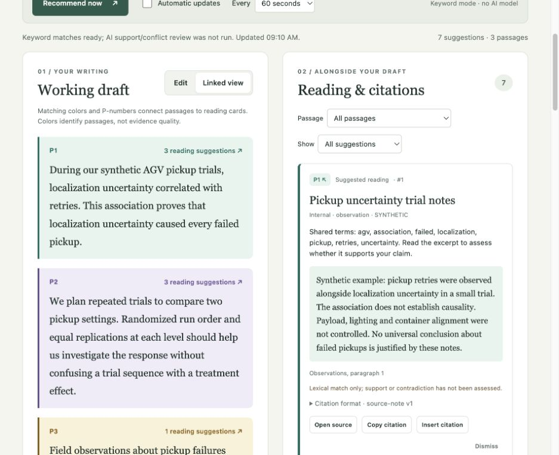

# REER Reading Assistant

A small, local reading and citation assistant. It connects draft paragraphs to relevant passages from **internal knowledge and curated external sources**, using matching colors and numbered labels. It runs independently of [Document Formatter](https://github.com/reer-robotics/document-formatter) and the company journal.



## Try it

Requires Python 3.11 or newer. Node 22+ is only needed for the browser-state tests; there are no frontend package dependencies.

```sh
python3 -m venv .venv
source .venv/bin/activate
python -m pip install -e '.[dev]'
readassist serve --port 4174
```

Open **http://127.0.0.1:4174/** and choose **Recommend now**. The demo includes three synthetic internal documents and two short, curated NIST excerpts. No company documents, account credentials, or model downloads are included.

1. Click a paragraph’s reading-suggestions link to filter its recommendations.
2. Use **P1 / P2 / P3** on a card to jump back to the same colored passage. The six colors repeat for longer drafts; paragraph numbers distinguish them. Color indicates association, never credibility.
3. Switch to **Edit** to change the draft, then **Linked view** to see its colored passage map. Recommendation cards remain alongside the editor on wide screens; narrow screens stack the panels.
4. Choose **Open source**, **Copy citation**, or explicitly **Insert citation**. Insertion adds a Markdown footnote marker to the matched paragraph and a source note to the download.
5. Enable **Automatic updates** for changed drafts at 30, 60, 120, or 300 seconds. Default is off with 60 seconds selected. Requests never overlap; hidden tabs pause checks. Old results are discarded if the draft changes during a request. Errors pause the timer.
6. **Download Markdown** before closing the tab. The browser holds draft and insertion state in memory, not persistent storage.

## Two execution modes

**Keyword mode (default):** no model and no network requests to sources. BM25-style lexical retrieval uses title, tags, and stored passages. A two-term overlap threshold avoids single-word matches. Relevant internal sources precede curated external sources; within each tier candidates rank by retrieval score. Up to four distinct sources per paragraph are shown. All cards are labeled *Suggested reading*; keyword overlap does not establish support or contradiction.

**Optional local AI:** choose one already installed Ollama model supporting completion and structured JSON output:

```sh
readassist --model YOUR_INSTALLED_MODEL serve --port 4174
```

One bounded assessment skill ranks retrieved candidates within their source tiers, explains relevance, and proposes *Possible citation* or *Possible conflict*. Source text, locations, authors, and citations are owned by the catalog and cannot be replaced by model output. The endpoint is fixed to `http://127.0.0.1:11434`; cloud models, redirect following, environment proxies, automatic downloads, and web discovery are excluded. There is no silent fallback after model failure.

No real model was run for this release. Model behavior is covered by mocked HTTP tests; semantic quality still needs evaluation on an installed model. A model suggestion is never a verified endorsement.

## Use it three ways

### Command line

```sh
readassist recommend src/reading_assistant/demo/draft.md --output recommendations.json
readassist --catalog /path/outside/public-repo/catalog.json --audience engineering recommend article.md
```

Global options (`--catalog`, `--audience`, `--model`) precede the subcommand.

### Python library

```python
from reading_assistant.engine import Recommender, load_catalog

engine = Recommender(load_catalog('/path/to/catalog.json'), audiences=['engineering'])
result = engine.recommend('Draft paragraph one.\n\nDraft paragraph two.')
# result['paragraphs'] links to result['recommendations'] by passage_id.
```

### Local HTTP / browser

`readassist serve` provides the browser and `POST /api/recommend`. The endpoint accepts only `{"draft": "..."}`. Obtain the per-process token from `/api/config` and send it in `X-Reading-Token`. This token protects the local demo from cross-origin requests; it is **not** user authentication. Permissions and model selection are configured by the process operator, never by the request body.

See [integration contracts](docs/integration.md) for embedding a side panel beside Decap or another editor. The demo does not yet install a Decap widget or change Docusaurus.

## Source and citation contract

- [Source catalog schema](src/reading_assistant/schemas/catalog.schema.json)
- [Recommendation schema](src/reading_assistant/schemas/recommendations.schema.json)
- [Adding sources](docs/sources.md)
- [Fixed workflow and skill](docs/workflow.md)
- [Contribution guide](CONTRIBUTING.md)

Each card carries its linked draft passage, source status, relevance explanation, verbatim stored excerpt, locator, citation metadata, and evidence hash. Citation style `source-note-v1` is a simple versioned format, not APA/IEEE compliance. Unknown authors and dates are explicitly missing. Bibliographic style adapters can be added without changing retrieval.

## Examples and checks

```sh
python examples/run_demo.py
pytest -q
node --test tests/state.test.mjs
python -m pip wheel --no-deps . -w dist
```

The example draft intentionally makes an unsupported causal claim, so the source excerpts illustrate why human scrutiny matters. It is not a robotics finding. Other [example drafts](examples/) cover method planning and a no-match query.

## Boundaries of version 0.1

This is a **single-user localhost prototype**, not an authenticated company deployment. Audience filtering demonstrates a trusted integration boundary; it is not SSO. Keep real catalogs outside the public repository. No open-web search, vector database, file parsing, automatic catalog synchronization, persistent draft storage, or production hosting is included. The catalog is a manually curated JSON collection; maximum 500 sources, 100 passages per source, 24 draft paragraphs, and 30,000 draft characters. Lexical retrieval is aimed at small English-language collections and does not understand synonyms reliably. A request that cannot fit the AI limit fails explicitly rather than truncating evidence.

Future work should follow feedback on this demo: authenticated source connectors, citation style adapters, richer retrieval and multilingual evaluation, and an editor integration. Open-web discovery remains a separately approved feature.

## External references

The two curated demonstration excerpts link directly to the [NIST scatter-plot guidance](https://www.itl.nist.gov/div898/handbook/eda/section3/scatterp.htm) and [randomized-design guidance](https://www.itl.nist.gov/div898/handbook/pri/section3/pri331.htm). Excerpts are short snapshots with explicit locators; missing publication dates are left blank. The local AI adapter uses Ollama’s [chat API](https://docs.ollama.com/api/chat) and [structured outputs](https://docs.ollama.com/capabilities/structured-outputs).
